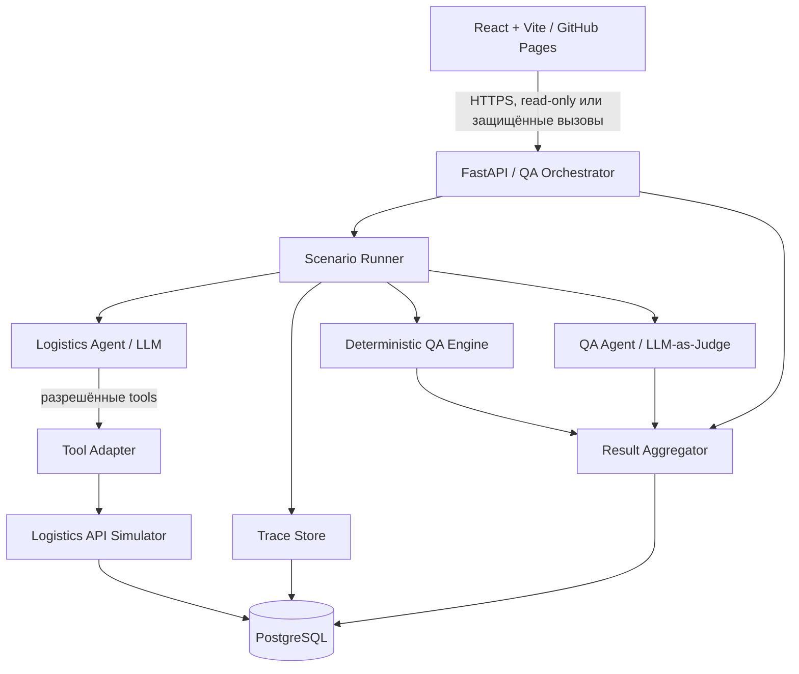

# Архитектура — исходные проектные решения

**Статус:** DRAFT · КТ1. Технологии и контракты утверждаются на КТ2; документ описывает границы, необходимые для проектирования.

## Компоненты и ответственность

- **Scenario Runner:** выбирает fixture/вариант, создаёт изоляцию, запускает процесс, собирает evidence, завершает с типизированным статусом.
- **Logistics Agent:** принимает пользовательскую задачу и решает, какие инструменты вызвать; не получает доступ к admin endpoints.
- **Tool Adapter:** инструменты с типизированными аргументами, timeouts, result IDs, безопасным логированием; полномочия проверяет backend.
- **Logistics API Simulator:** состояние заказов и обращений, правила, идемпотентность; синтетические данные.
- **QA Engine:** структурированные проверки БД, tool policy, авторизации, количества записей и версий событий без вызова LLM.
- **QA Agent:** отдельный LLM-контекст с рубрикой, трассой, ссылками на требования; не имеет прав изменять состояние тестируемой системы.
- **Result Aggregator:** финальный вердикт с приоритетом обязательных детерминированных проверок.
- **Frontend:** показывает два агента отдельно, QA Engine, доказательства, историю, JSON экспорт. Прототип v0.2 служит UI-референсом.

## Режимы
- `replay`: заранее записанная трасса и ожидаемые изменения без вызова LLM, пригодно для CI и демонстрации без сервера при наличии статических экспортов.
- `live`: реальные вызовы LLM через сервер; с ограничениями бюджета и доступов.

## Состояния запуска
`CREATED → PREPARING → RUNNING_AUT → EVALUATING → COMPLETED`; терминальные `COMPLETED`, `ERROR`, `CANCELLED`. Финальная оценка из `PASS | FAIL | ERROR | INCONCLUSIVE` хранится отдельно от жизненного цикла задания.

## Ограждения
- Нельзя выдавать QA Agent права на запись в Logistics API.
- Секреты только на сервере; продакшн-подключения запрещены.
- Run isolation: отдельный namespace/tenant/transaction/схема на запуск (конкретную реализацию выбрать на КТ2).
- Логи хранят только наблюдаемые outputs/messages/tool inputs, не приватный скрытый chain-of-thought.
- Не считать AI-суждение доказательством изменения БД. Нужен независимый query/evidence.
- Replay должен уметь демонстрировать **настоящую логику оценки**, а не код `if defective then FAIL`.

## Предварительный стек
Python/FastAPI, pytest/httpx, PostgreSQL, Docker Compose, React/TypeScript/Vite, GitHub Actions. LLM-provider и agents SDK выбираются по результатам технического spike; обеспечить адаптер, не зашивать провайдера в доменные правила.

## Публичное размещение
На КТ1 сервер не арендуется. Public frontend публикуется как read-only демо с записанными результатами; интерактивный backend размещается позже по отдельному решению. Адреса CORS и HTTPS определяются на КТ11.
