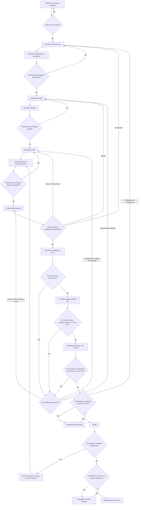

# Разработка по спецификации

## Источники и инструменты

КТ1 остаётся нормативной базой требований и сценариев. Ссылайся на [требования](../02_REQUIREMENTS.md), [сценарии](../03_SCENARIOS.md) и [базовую линию](../KT1_BASELINE.md). Сохраняй идентификаторы `REQ-XXX` и `S01–S06`. Не копируй их нормативный текст в OpenSpec. Для нового поведения используй свои идентификаторы требований `AC-*` и сценариев `SC-*` в заголовках OpenSpec. Если новое поведение противоречит КТ1 или зависит от DEC-01–07, остановись и запроси отдельное решение пользователя. DEC-01–07 остаются открытыми.

Закреплена версия OpenSpec **2.1.1**. Источник дистрибутивов — [официальный релиз и SHA256SUMS](https://github.com/Fission-AI/OpenSpec/releases/tag/v2.1.1). Сначала сверяй архив с опубликованным SHA-256, затем извлекай исполняемый файл и сверяй его с проверенным значением ниже. Бинарники не включаются в Git. Для CI используется Linux x64 на Ubuntu 24.04. Standalone не требует установки Node.

| Платформа | Архив и SHA-256 | Извлечённый файл и SHA-256 |
| --- | --- | --- |
| Windows x64 | `openspec-windows-x64.zip` · `d0596470784b9edf4f015b0763d071908f379913fcef524a5cba5d7ec0fc7943` | `openspec.exe` · `c51fc902f21fc70942c9f9e4eba2b301f8fa5340affec7e29fa19e5a06541064` |
| Linux x64 | `openspec-linux-x64.tar.gz` · `22f0c7c96cc14138becb42aa98e589050c94cda793cbefd7e7ac2d7dee78b6d5` | `openspec` · `5d0fc1b5cd838f3859e35c203ee8bd6e2387b8c807da24a2b1bda626ef43be3d` |

На Windows проверь файлы через `Get-FileHash -Algorithm SHA256`, распакуй архив через `Expand-Archive` в отдельный каталог и запусти извлечённый `openspec.exe` по полному пути. На Linux CI проверка выполняется через `sha256sum -c` до и после распаковки. Для локальных запусков можно отключить телеметрию переменной `OPENSPEC_TELEMETRY=0`.

В VS Code открой корень репозитория. Навыки Codex хранятся в `.agents/skills/` и вызываются по имени, например `$openspec-propose`. Сгенерированные навыки уже входят в репозиторий. Для установки в новом окружении проверь `openspec --version`. Перегенерацию выполняй из корня через `openspec init --scope project --tools codex` и проверяй diff. Встроенный набор включает `$openspec-apply-change`, `$openspec-sync-specs` и `$openspec-archive-change`. Перед действием учитывай ворота ниже. [OpenSpec 2.1.1 для Codex](https://github.com/Fission-AI/OpenSpec/blob/v2.1.1/docs-lab/reference/supported-tools.md)

## Ворота

В начале изменения закрепи `change-id`, GitHub Issue и границы в `proposal.md`. В Issue веди журнал стадий. Для каждой строки укажи `change-id`, стадию, статус (`ожидает`, `утверждена`, `отклонена`, `требует повторного утверждения` или `выполнена`), версию артефакта (полный commit SHA и путь), ссылку на решение пользователя или доказательство, дату и результат. Решение записывается ссылкой на подтверждение. Если оно получено вне GitHub, укажи место и дату и зафиксируй формулировку в доступном сторонам журнале. При изменении утверждённого артефакта затронутая стадия и зависимые от неё стадии снова требуют решения. Состояние задач в OpenSpec не заменяет запись об утверждении.

Шаблон строки журнала:

```text
change-id | стадия | статус | полный SHA:путь | решение или доказательство | дата | результат
```



| Этап | Входные данные | Критерий перехода | Результат | Ответственные |
| --- | --- | --- | --- | --- |
| GitHub Issue | Цель, границы работы, критерии приёмки | Указаны scope, критерии и связанные ограничения КТ1 | Issue готова к проработке требований | Автор, владелец задачи |
| 1. Requirements | Готовая Issue, сценарии и требования КТ1 | Строгая валидация дельты и проверка ссылочных ID. Пользователь утвердил требования и сценарии | Версия требований и решение в журнале | Автор, пользователь |
| 2. Design | Утверждённые требования и ограничения | Структура артефактов проверена в пределах возможностей CLI. Пользователь утвердил дизайн | Версия дизайна и решение в журнале | Автор, пользователь |
| 3. Tasks | Утверждённый дизайн, текущий срез задач | Определены scope, критерии и связи с проверками. Пользователь утвердил задачи и критерии среза. Запланированный тест можно написать на этапе реализации | Версия задач и критериев, разрешение начать срез | Автор, пользователь |
| 4. Implementation и локальные тесты | Утверждённые требования, дизайн и задачи | Применимые локальные проверки, включая check-sdd, прошли. Критерии задач подтверждены. Если нужен пересмотр утверждённого артефакта, вернись на соответствующую стадию | Кандидат в PR с доказательствами по задачам | Codex, автор |
| 5. CI и SDD | HEAD PR и manifest среза | Успешны OpenSpec, checker и применимые тесты, включая тесты checker, на точном HEAD | Ссылки на проверки для ревью этого SHA | CI, автор |
| 5. Независимое ревью и приёмка PR | Тот же SHA, успешный CI, утверждённые артефакты, diff и доказательства | Независимый ревьюер проверил смысл изменений, scope и результаты. Все критерии PR выполнены. Пользователь принял срез и отдельно разрешил merge этого SHA | Отчёт ревью и разрешение на merge | Независимый ревьюер, пользователь |
| Merge и следующий срез | Разрешённый SHA и журнал задач изменения | Слить только разрешённый SHA. Если остались задачи, выбрать следующий срез того же `change-id` и снова проверить его задачи и критерии | Слитый PR и следующий срез либо готовность к итоговой приёмке | Автор, пользователь |
| 6. Sync / Archive | Все задачи выполнены и приняты пользователем | Валидация активных и действующих спецификаций, проверка завершённости задач и согласованности с КТ1 | Дельта в действующей спецификации, завершённое изменение в архиве | Пользователь утверждает, автор выполняет |

После обычного исправления кода или тестов повтори локальные проверки, CI и независимое ревью нового SHA. При пересмотре утверждённых требований либо дизайна повторно проверь и согласуй затронутый артефакт и зависимые стадии. Сам по себе merge одного среза не разрешает синхронизацию всей дельты.

Эти ворота дополняют [процесс ревью](review-process.md) и [системный аудит](audit-process.md). Каждый PR связан с Issue через Development. В описании PR указываются `change-id`, срез задач, доказательства, версия утверждённых артефактов и точный SHA для ревью.

## Срезы и проверка

Один change-id может охватывать несколько PR. В каждом срезе добавляй или обновляй ровно один `openspec/verification/<change-id>/<slice>.json`. Согласуй список путей до реализации. Ревьюер сравнивает список с версией, которую утвердил пользователь, включая изменения самого manifest. Автоматическая проверка сравнивает diff с заявленным списком, она не удостоверяет полномочия автора или факт согласования.

| Поле manifest | Формат |
| --- | --- |
| `change_id`, `issue`, `kind` | ID соответствует каталогу, Issue — номер единственной основной привязки Development, тип — `implementation`, `tooling` или `planning` |
| `scope`, `tasks` | Точные относительные пути без масок, включая manifest, и номера задач этого PR |
| `targets` | Словарь именованных целей. Поля `requirement`, необязательный `scenario`, а для OpenSpec путь `spec`. Идентификаторы берутся из КТ1 или из заголовков OpenSpec |
| `links` | Строки с `task`, именем `target` и одним из `test` или `manual`. Тест задаётся как `path/test_file.py::test_name` или `path/test_file.py::Class::test_name`. Для согласованной ручной проверки указывается путь к Markdown-записи со строками `Command: <команда или процедура>`, `Result: PASS` и `Evidence: <ссылка или результат>` |

Для реализации номер задачи должен существовать в `tasks.md` своего change-id. Срез может ссылаться на действующие спецификации. Активная дельта должна принадлежать этому срезу по change-id. Каждая цель и задача требуют связи с проверкой. При изменении секции требований OpenSpec перечисли затронутые требования и сценарии. При `RENAMED` сохраняй ID из `FROM` в `TO`; для переименования без изменения сценариев указывай цель на требование без поля `scenario`. Существующие тесты можно переиспользовать, если они реально проверяют заявленное поведение. Отсутствие изменений в specs или тестовых файлах не даёт автоматического зачёта. Для чисто технического PR с `kind: tooling` без продуктовых требований требуется `reason` и проверка каждой задачи. Bootstrap интеграции использует этот режим и ссылается на Issue №5. Продуктовый код и изменения спецификаций требуют обычного manifest.

Проверка CI использует точный HEAD и общую базу с целевой веткой. Запускаются `openspec validate --all --strict --no-interactive`, отдельная валидация архивных задач и `python3 scripts/check-sdd.py --base <base-sha> --issue <issue-number>`. Checker сверяет защищённые файлы КТ1 с принятым коммитом, учитывает обе стороны переименований файлов, вложенные спецификации и операции над требованиями. Список задач использует нумерованные ID и допускает маркированные и нумерованные чекбоксы Markdown. Для обновления действующих спецификаций или архива все чекбоксы должны быть закрыты. Это техническое условие дополняет подтверждение пользователя. AST проверяет объявление теста. Автор и ревьюер подтверждают фактическую сборку, выполнение и качество теста по журналу CI. Непрошедшая, пропущенная или отсутствующая обязательная проверка блокирует принятие среза.

### Приёмка planning baseline

Для изменения из нескольких продуктовых PR можно отдельно принять утверждённый план. Planning PR создаётся после утверждения Requirements, Design и Tasks. У него один действующий change-id и одна привязка GitHub Development. Режим `planning` допускает первичное добавление только следующих файлов:

- `openspec/changes/<change-id>/.openspec.yaml`, `proposal.md`, `design.md`, `tasks.md` и хотя бы одной дельты `specs/<capability>/spec.md` в этом change.
- Одного `docs/development/<name>-business-decisions.md`. Proposal содержит change-id и ссылку на этот файл. Proposal и документ решений ссылаются на ту же Issue.
- `openspec/verification/<change-id>/planning.json`. В `scope` перечислены точные пути diff, включая сам манифест. Поле `decisions` содержит путь к документу решений. В `artifacts` каждому пути комплекта, кроме манифеста, соответствует SHA-256 полных байтов Git-объекта файла на HEAD. Идентификатор Git blob и хеш рабочей копии с преобразованными окончаниями строк для этого поля не подходят. Поля `tasks`, `targets` и `links` имеют значения `[]`, `{}` и `[]`.

Задачи в `tasks.md` оформляй верхнеуровневыми пунктами с уникальными номерами, пустыми чекбоксами и ссылками на требования AC и сценарии SC. Каждый SC принадлежит указанному AC, и весь набор сценариев покрыт трассировкой плана. В строке задачи укажи один маркер `После: 1.1, 1.2.` с номерами уже перечисленных задач или `После: нет.`. У первой задачи можно указать внешнее условие старта без номера задачи. Для последовательных числовых ID допустима запись диапазона с одним повторяемым префиксом, например `SC-ABC-001–003`. Checker пропускает кодовые примеры и HTML-комментарии при чтении задач. В примерах показывай чекбоксы внутри строки или убирай пример перед архивированием, поскольку OpenSpec 2.1.1 включает отдельные строки с чекбоксами из примеров в архивный счётчик.

CI выполняет строгую валидацию OpenSpec и проверку planning-манифеста. Ревьюер сверяет точные SHA-256 с утверждёнными артефактами в Issue и проверяет согласованность proposal, DEC, требований, дизайна и задач. Контроль целостности и трассировки подтверждает приёмку плана. Продуктовое покрытие на этой стадии отсутствует.

После приёмки planning baseline реализация ссылается на утверждённую дельту из базы и предъявляет доказательства задач своего среза через отдельный манифест `implementation` для той же Issue. Checker сверяет каждую связь с AC/SC утверждённой задачи. Отметить задачу выполненной можно после её зависимостей и при наличии доказательства по каждой её связи AC/SC. Частичные результаты допустимы для незакрытой задачи. Записи о доказательствах добавляй вне утверждённых строк задач и предъявляй ревьюеру.

Принятый `planning.json`, документ решений и файлы change закреплены. При синхронизации текст публикуемых требований должен совпадать с утверждённой дельтой. При отдельном согласованном архивировании закреплённые файлы change переносятся побайтно в один каталог вместе с журналом задач. Повторное использование архивного change-id отклоняется. При необходимости изменить утверждённое поведение требуется отдельное согласование и отдельный процесс обновления базовой линии до продолжения продуктового среза.

## Актуальная спецификация

Для нового поведения действующий текст хранится в `openspec/specs/`, для КТ1 — в исходных нормативных документах. Пока хотя бы одна задача изменения не реализована и не принята, вся дельта остаётся в `openspec/changes/<change-id>/`. Если части должны завершаться независимо, разнеси их по разным change-id с явными зависимостями. OpenSpec не определяет, какая часть дельты реально реализована.

После приёмки всех задач перенеси согласованные дельты в действующие спецификации и проверь diff. Для новой возможности опиши её назначение в `## Purpose`, чтобы после переноса в действующей спецификации не осталось заглушки. Можно выполнить синхронизацию навыком `$openspec-sync-specs`, затем архивировать, либо применить дельты при `openspec archive <change-id>`. Закрытое изменение хранится в `openspec/changes/archive/`. Перед merge проверь согласованность с актуальным `main` и неизменность файлов КТ1. Изменение действующей нормы КТ1 требует отдельного решения и согласованной смены базовой линии. [Валидация и архивирование OpenSpec](https://github.com/Fission-AI/OpenSpec/blob/v2.1.1/docs-lab/reference/cli.md)
