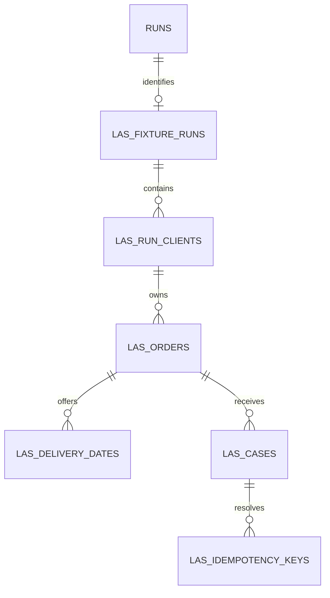

# Design КТ3 — Logistics API Simulator

Change `kt3-logistics-api-simulator`. Проектирование охватывает четыре согласованных среза. База КТ2 `dedd5c353010b89fecbf0969b8034003c13b256e`. Requirements и HTTP-контракты утверждены на `771ff22de5b9f58411dcacc15d9443c6b9334a38`. [Журнал утверждения](https://github.com/andreigkuznetsov/ai-agents-qa-demo/issues/14) · [Proposal и HTTP](proposal.md) · [Requirements](specs/logistics-api-simulator/spec.md) · [DEC-01–07](../../../docs/development/kt3-business-decisions.md)

## Context

КТ2 уже предоставляет FastAPI, асинхронный доступ к PostgreSQL через SQLAlchemy и psycopg, Alembic, отдельный мигратор, техническую запись запуска и проверки health. Симулятор добавляется в тот же backend и ту же PostgreSQL с логическим разделением данных по запуску и клиенту. Утверждённые спецификации КТ2 и четыре поля `qa.runs` сохраняются. [Архитектура КТ2](../../../docs/development/kt2-architecture.md)

## Goals / Non-Goals

- Отделить аутентификацию, правила заказов, транзакции записи, сверку результата и внутреннее управление тестом.
- Дать проверяемый результат API и БД для SC-LAS-001–022. Пользовательский доступ ограничен шестью утверждёнными маршрутами. Закрытие обращений и изменение фактического расписания не входят в КТ3.
- Планирование поведения Logistics Agent, QA Agent, QA Engine, внешнего административного API и полного replay остаётся за пределами этого дизайна.

## Decisions

### D-LAS-01. Данные и границы принадлежности

Предлагаемые таблицы размещаются в существующей схеме `qa`. Во всех доменных ключах и ссылках используются доверенные области. `client_id`, `order_id` и `request_key` — непрозрачные строки с точным сравнением в детерминированной коллации `C`, без преобразования в число или изменения регистра. Даты — PostgreSQL `date`. Публичный ID case — UUID в JSON-строке. Компоненты ключей и обязательные поля `NOT NULL`. Ссылки запрещают удаление родителя при наличии зависимых данных. Автоматическая очистка данных при загрузке fixtures отсутствует. [Составные внешние ключи PostgreSQL](https://www.postgresql.org/docs/18/ddl-constraints.html#DDL-CONSTRAINTS-FK)

| Сущность | Поля, ключи и ограничения | Доступ и индекс |
| --- | --- | --- |
| `qa.runs` | Существующие `run_id`, `schema_version`, `created_at`, `status`. `run_id` остаётся PK. | Права КТ2 сохраняются. |
| `qa.las_fixture_runs` | PK/FK `run_id → runs`, `fixture_version`, `content_sha256`. Поля версии и суммы фиксируют исходное содержимое. | PK также обслуживает сравнение при повторной загрузке. |
| `qa.las_run_clients` | PK `(run_id, client_id)`. FK на `las_fixture_runs`. | Родитель принадлежности доменных объектов. Токены в таблице не хранятся. |
| `qa.las_orders` | PK `(run_id, client_id, order_id)`, FK `(run_id, client_id)` на клиента запуска. `status` ограничен `ACTIVE` и `TRANSFER_BLOCKED`, отдельное поле `scheduled_delivery_date`. | PK обслуживает чтение и проверку принадлежности. Одинаковый номер заказа допускается в разных областях. |
| `qa.las_delivery_dates` | PK `(run_id, client_id, order_id, delivery_date)`, составной FK на заказ. | PK обслуживает проверку выбранной даты и выдачу упорядоченного списка. |
| `qa.las_cases` | PK `(run_id, client_id, case_id)`, составной FK на заказ. `requested_date`, `operation_type=DELIVERY_RESCHEDULE`, `status=OPEN` и ограничения допустимых значений. Уникальность бизнеса по `(run_id, client_id, order_id, requested_date, operation_type)`. | Индекс уникальности бизнеса обслуживает поиск дубликата и чтение списка по заказу. Ссылочный уникальный ключ добавляет `case_id` к полям бизнеса. |
| `qa.las_idempotency_keys` | PK `(run_id, client_id, operation_type, request_key)`. Дополнительно сохраняются `order_id`, `requested_date`, `case_id`. Составной FK на ссылочный ключ case, включая принадлежность, заказ, дату и тип. | PK обслуживает чтение по ключу. Индекс на стороне FK добавляется для проверок целостности case. Равенство запроса проверяется по типизированным сохранённым полям. |

Уникальность бизнеса полная для таблицы, поскольку в КТ3 все case имеют статус `OPEN`. Исторический case и его ключ остаются пригодными для чтения после изменения списка дат. Поэтому `requested_date` в case не является FK на изменяемый список вариантов. Дату проверяют при новой записи. Нормальный бизнес-маршрут не меняет состояние заказа, исходную дату, строки вариантов или ранее сохранённый case.

### D-LAS-02. Аутентификация, полномочия и маршруты

На входе FastAPI выделяется зависимость аутентификации для логистического роутера. В MVP доверенная серверная конфигурация связывает SHA-256 высокоэнтропийного синтетического токена с одним `(run_id, client_id)`. Случайный непрозрачный токен получает только тестовый клиент или доверенный адаптер, конфигурация не попадает в Git. Отсутствующий или неверный Bearer получает `401 UNAUTHENTICATED` до бизнес-валидации. Для записи порядок контролируется явно, включая невалидный JSON, чтобы стандартная ранняя валидация HTTP-фреймворка не меняла приоритет. Поля запроса не становятся источником полномочий.

Обработчик получает неизменяемый контекст авторизации. Хранилище все операции ограничивает одновременно `run_id` и `client_id`, передаваемыми из него, и использует параметризованные значения. Наличие технического `run_id`, одного идентификатора заказа или case прав не даёт. Составные FK защищают от расхождения области при записи. Единый формирователь ошибки для отсутствующего, чужого и недоступного из другого запуска объекта возвращает один `404 RESOURCE_NOT_FOUND` без диагностических полей. Внутреннее свидетельство отказа содержит маршрут, безопасный код и технический идентификатор корреляции. Токен, ключ, тело запроса, чужие данные и параметры SQL в свидетельство не входят.

| Метод и маршрут | Ответ и граница | Эффект |
| --- | --- | --- |
| `GET /orders/{order_id}` | Bearer, `200` с согласованными полями заказа владельца. При отсутствии доступа единый `404`. | Чтение. |
| `GET /orders/{order_id}/delivery-options` | Bearer, `200` со списком ISO-дат, `eligible` и `reason_code`. Различаются `ORDER_TRANSFER_BLOCKED` и `NO_AVAILABLE_DATES`; заказ вне контекста даёт `404`. | Чтение заказа и дат из согласованного снимка. |
| `POST /cases` | Bearer, `Idempotency-Key`, утверждённые бизнес-поля. Возвращает `201` или `200 CASE`, либо согласованные коды ошибок по D-LAS-03. | Запись case и привязки либо только новой привязки к существующему case. Сохранённый ответ по прежнему ключу возвращается без записи. |
| `GET /orders/{order_id}/cases` | Bearer, `200 {"cases":[...]}` для доступного заказа, в том числе пустой список. Недоступный заказ даёт `404`. | Чтение. |
| `GET /cases/{case_id}` | Bearer, `200 CASE` для case в области доступа, иначе `404`. | Чтение. |
| `GET /orders/{order_id}/case-result` | Bearer и исходный `Idempotency-Key`. `200 FOUND`, `200 NOT_FOUND` или `503 RESULT_CHECK_UNAVAILABLE` после авторизации. При недоступном заказе единый `404`. | Чтение, без блокировок записи и побочных изменений. |

Любое чтение возвращает только утверждённую публичную проекцию. Единый формат ошибок, поля, значения и HTTP-статусы заданы базой Requirements. Существующий health-роутер остаётся отдельным. Клиентскому токену не соответствует право обращения к загрузчику или настройке отказов.

### D-LAS-03. Транзакция создания и идемпотентность

**Порядок работы с соединением.** Используется прежний пул `AsyncEngine` с диалектом PostgreSQL/psycopg. Логистическая операция получает `AsyncConnection` через `await engine.connect()`. Сразу после checkout, внутри области гарантированной очистки, на ещё свободном соединении выполняется `await connection.execution_options(isolation_level="READ COMMITTED")`. До этого прикладной код не выполняет SQL, включая `SHOW`, проверку ревизии и настройку локальных тайм-аутов. Встроенный `pool_pre_ping` выполняется диалектом при checkout. Проверка на закреплённых версиях драйвера и SQLAlchemy должна подтвердить, что он оставляет psycopg-соединение в состоянии `IDLE` и у SQLAlchemy нет активной транзакции. После установки изоляции выполняется `await connection.begin()`, затем на том же соединении проверяется ревизия, применяются локальные параметры транзакции и выполняются доменные запросы. Прикладной код не переключает psycopg в autocommit и не использует SQL `SET SESSION` для смены изоляции. [Изоляция и autobegin в SQLAlchemy](https://docs.sqlalchemy.org/en/21/core/connections.html#sqlalchemy.engine.Connection.execution_options)

В КТ2 `Database.transaction()` сейчас начинает транзакцию сразу после checkout, затем вызывает `assert_compatible`. Для логистических операций потребуется добавить выбор изоляции в промежутке между checkout и `begin()`, используя ту же границу владения соединением и проверки ревизии. Существующие вызовы health и RunStore сохраняют прежние настройки и последовательность. При успешной фиксации или подтверждённом rollback закрытие `AsyncConnection` возвращает соединение в пул и восстанавливает исходный уровень изоляции средствами SQLAlchemy. При потере или недостоверном состоянии соединение инвалидируется и закрывается. На инвалидированном объекте операция не продолжается.

**Протокол блокировок.** Для POST порядок **ключ → заказ**. Внутреннее изменение статуса или дат начинает свою транзакцию и берёт только ту же блокировку заказа до первого чтения, влияющего на изменение, и до записи. Для обеих сторон используется один способ вычисления ключа: пространства имён ключа и заказа разделены, UUID запуска кодируется 16 байтами, строковые поля кодируются точными байтами UTF-8 с префиксами длины, без нормализации. Один общий преобразователь строит аргумент `pg_advisory_xact_lock` из префикса пространства имён и усечённого SHA-256 составного идентификатора. Префикс хранится в зарезервированных битах аргумента. Идентификаторы — `(run_id, client_id, operation_type, request_key)` и `(run_id, client_id, order_id)` соответственно. Коллизия приводит к лишнему ожиданию. Поиск, полномочия и уникальность используют полные идентификаторы. Обе стороны держат блокировку заказа до конца транзакции. [Транзакционные блокировки PostgreSQL](https://www.postgresql.org/docs/18/explicit-locking.html)

Для внутренних изменений действует тот же `READ COMMITTED`. Формат аргумента блокировки общий для обеих сторон: префиксы длины строк — 32-битные беззнаковые числа в big-endian, аргумент PostgreSQL — положительный `bigint` из трёх старших битов пространства имён, включая нулевой знаковый бит, и 61 бита SHA-256. Пространства 1, 2 и 3 закреплены за ключом, заказом и инициализацией fixtures соответственно. От общего правила ожидается стабильность между процессами и рестартами.

1. Аутентифицировать Bearer, проверить форму ключа и бизнес-полей. Для сравнения используются точный `order_id`, представление даты `YYYY-MM-DD` и точное значение `DELIVERY_RESCHEDULE`. Порядок полей, пробелы сериализации и эквивалентное JSON-экранирование не учитываются.
2. Открыть транзакцию и подтвердить доступ к заказу в доверенной области **до поиска ключа**. Взять блокировку ключа в области `(run_id, client_id, operation_type, key)`, затем блокировку заказа в области `(run_id, client_id, order_id)`. Перепроверить принадлежность. При ожидании блокировок бюджет запроса продолжает действовать.
3. Прочитать ключ отдельным оператором после получения блокировок. Если результат совпадает по содержимому, вернуть сохранённый case с `200`, без проверки изменившихся состояния и дат. Если содержимое различается, вернуть `409 IDEMPOTENCY_KEY_CONFLICT`, без изменений в БД. Заказ, к которому права потеряны, получает единый `404` ещё до ветки ключа.
4. При новом ключе проверить текущее состояние `ACTIVE` и текущий список допустимых дат. При отказе применить `409 ORDER_TRANSFER_BLOCKED` или `422 DELIVERY_DATE_NOT_ALLOWED` без привязки ключа. Только после этих проверок найти бизнес-дубликат. Для найденного case записать привязку нового ключа и получить `200`. Для нового case сохранить case и ключ в общей транзакции и получить `201`.
5. Отправлять успешный HTTP-ответ только после известной успешной фиксации. При подтверждённом откате case и ключ отсутствуют вместе либо исходный существующий case остаётся без новой частичной привязки. При неизвестном результате commit клиента направляет утверждённый путь сверки. Автоматический повтор `POST` отсутствует.

Новый POST после получения блокировки заказа читает состояние и варианты свежим оператором под `READ COMMITTED`. Если внутреннее изменение зафиксировалось первым, POST применяет новые условия. Если допустимый POST зафиксировался первым, внутреннее изменение ждёт и затем меняет только заказ или варианты. Исторический case и ключ сохраняются. Внутренние изменения используют доверенный тестовый процесс без публичного маршрута. Ограничения БД остаются последней защитой.

**Отмена и завершение.** SQL-ошибка, включая серверный тайм-аут lock или statement, завершает операцию. При управляемом соединении выполняется rollback через ограниченную по времени очистку КТ2. При отмене coroutine во время ожидания advisory lock, установки параметров, проверки ревизии или иной операции внутри открытой транзакции используется отслеживаемая очистка КТ2 с инвалидированием и закрытием соединения вне отменённого запроса. В тесте подтверждается завершение серверной транзакции и освобождение всех её блокировок, включая уже взятую блокировку ключа при отмене ожидания заказа. При сбое rollback или восстановления состояния соединение исключается из пула. После SQL-ошибки та же транзакция не используется, технический конфликт ограничения не преобразуется автоматически в бизнес-`409`.

Граница записи различает подтверждённый rollback, подтверждённый commit и неизвестный исход. При потере соединения, ответа драйвера или отмене во время commit исход остаётся неизвестным, пока нет независимого подтверждения. Соединение инвалидируется. Даже если фиксация успела произойти на сервере, API не посылает ложный `200/201` и не повторяет POST. Одна авторизованная сверка проверяет результат по исходному ключу. Последующий rollback либо закрытие соединения не доказывают, что commit не состоялся. Публичный каталог ответов сохраняется.

### D-LAS-04. Сверка и видимость незавершённой записи

Сверка не захватывает advisory-блокировки, не использует `FOR UPDATE` и не ждёт завершения первоначального `POST`. Один SQL-оператор под `READ COMMITTED` читает доступный заказ и видимую привязку ключа с case. Он различает отсутствие заказа и отсутствие привязки при доступном заказе. Результат фильтруется по `run_id`, `client_id`, `order_id`, `DELIVERY_RESCHEDULE` и исходному ключу. CASE и ключ становятся видимыми для других транзакций после фиксации общей транзакции. На этом поведении основана интерпретация исходов. [Снимки READ COMMITTED PostgreSQL](https://www.postgresql.org/docs/18/transaction-iso.html#XACT-READ-COMMITTED)

- `200 FOUND` возвращает подтверждённый case, видимый в момент запроса.
- `200 NOT_FOUND` означает доступный заказ и успешное чтение, при котором подтверждённой записи ещё нет. Это включает транзакцию с выполненными INSERT до commit. Если исходный POST позже фиксируется, в БД остаётся ровно один case.
- `503 RESULT_CHECK_UNAVAILABLE` означает, что подтверждённое чтение не состоялось из-за технической недоступности, исчерпания пула или бюджета. Граница ошибки не превращает техническую недоступность в отсутствие записи.
- При невалидной аутентификации возвращается `401`. Если чтение доказало недоступность заказа, возвращается единый `404`. Сверка не возвращает ключ из другого контекста и не меняет состояние.

### D-LAS-05. Fixtures и минимальные полномочия

Внутренний тестовый загрузчик получает версионированный набор явно. Предложение для формата — один UTF-8 JSON bundle на версию, с фиксированными LF в Git и без BOM. SHA-256 вычисляется по всем байтам реально прочитанного bundle, включая расписание, варианты, владельцев и начальные case. Исходные байты проверяются и загружаются из одного чтения. Номер версии, имя файла или заявленный хеш не заменяют расчёт. Токены и секреты не входят в fixture. Сравнение даты с текущим календарём при загрузке не используется.

Загрузчик действует с отдельными от API полномочиями, в КТ3 через `qa_migrate` только в доверенном тестовом процессе на изолированной БД. Одна транзакция под отдельной блокировкой инициализации `run_id` проверяет отсутствие метаданных или пару `(fixture_version, content_sha256)`. При первом запуске она атомарно сохраняет доступные в срезе сущности и метаданные. Совпадающий повтор завершается без доменной записи, даже если состояние уже изменилось. Несовпадение любого элемента пары даёт контролируемый внутренний отказ с откатом. Автоматического исправления, перезагрузки или очистки другого запуска нет. Если отдельный внутренний тестовый шаг меняет статус или варианты заказа, он использует блокировку заказа из D-LAS-03.

В PR 1 валидируется полный bundle, включая описание начального case S04. Первоначальная материализация использует только введённые к этому срезу сущности. В PR 3 case S04 создаётся при первой загрузке **свежего run_id** на новой схеме. Повтор существующего запуска PR 1 не считается операцией довнесения и не изменяет его состояние. Миграция также не добавляет seed-данные.

API получает `SELECT` на заказы, даты, case и ключи, а доменный `INSERT` только на case и ключи. Доступ к `runs` и `alembic_version` остаётся по КТ2. Метаданные fixtures и реестр клиентов запуска доступны доверенному загрузчику. API не получает UPDATE, DELETE, DDL, прав на загрузку fixture или доступ к миграторским credentials.

### D-LAS-06. Изолированный внутренний механизм отказов

Внутренний интерфейс тестовой инфраструктуры выбирает версионированный профиль по `run_id`, контролируемой операции и фазе. Контроллер передаётся тестовому приложению при сборке зависимостей. В штатной сборке используется пустой контроллер. Выбор ограничен одним синтетическим запуском и заданным вызовом. Публичные body, заголовки, токены клиента и логистические маршруты не управляют профилем. Числа вызовов и точки остановки задаёт тест, без зависимости от случайных задержек.

| Точка теста | Положение | Ожидаемое доказательство |
| --- | --- | --- |
| Ошибка до commit | После попытки записи до фиксации case и ключа | Rollback обеих записей и отсутствие подтверждения. |
| Незавершённая запись | Первая транзакция дошла до барьера перед commit. Вторая делает одно независимое чтение. | Успешный `NOT_FOUND` до снятия барьера. После разрешённого commit в БД один case и связанный ключ. |
| Потеря ответа после commit | После фиксации case и ключа, до доставки результата вызывающему | Сверка подтверждает тот же case. Счётчик записей равен одному. |
| Недоступность сверки | Доверенная точка чтения в выбранном запуске | `503 RESULT_CHECK_UNAVAILABLE`. Второй запуск продолжает сверку без этого отказа. |

Тот же внутренний интерфейс сможет вызывать будущий QA Orchestrator со своими полномочиями. Сетевой административный маршрут в КТ3 отсутствует. Ожидания тестов ограничены по времени, барьеры освобождаются и транзакции завершаются и при падении теста.

### D-LAS-07. Тайм-ауты и диагностика

Бизнес-бюджеты записи и сверки отдельны и конфигурируемы. Используется монотонный общий дедлайн операции с учётом взятия соединения, ожидания блокировки, SQL и фиксации. Ограничения конкретного SQL или lock ожидания могут сужать оставшийся бюджет в рамках транзакции. Они не повышают утверждённые ограничения пула, SQL, health и запуска КТ2. При отмене используются существующие правила безопасного освобождения или инвалидирования соединения. Пропущенный клиентом ответ может оставить исход commit неизвестным.

Численных значений дизайн не назначает. До фиксации эксплуатационных дефолтов снять время тёплого и холодного получения соединения, время записи и сверки отдельно, ожидание блокировок под согласованной конкурентной нагрузкой, время commit и время очистки после отмены. Использовать синтетические fixtures и реальные CI-подобные PostgreSQL 18.7, указывать версии, размеры выборок, профиль нагрузки, медиану и хвост распределения отдельно для успешных и отказавших операций. По результатам представить конкретные дефолты и допуски на утверждение. Тесты границ могут использовать собственные явные бюджеты и управляемые барьеры с фиксированным сценарием. Числа теста не выдаются за эксплуатационные дефолты.

## Migration Plan

1. **PR 1.** Добавить линейную ревизию после `0001_runs` для fixture metadata, клиентов, заказов и дат. Нормативный состав `runs` сохраняется. Расширить проверку источника мигратора, которая сейчас допускает только пустую БД или уже упакованный head. Новый контракт допускает явно известный технический предок и только при соответствии его каталога объектов и прав. Обрабатывать неизвестный, разветвлённый и неполный источник как отказ.
2. **PR 2.** Добавить чтение заказов и вариантов на готовых таблицах. Новая ревизия не нужна, если в срезе нет изменений схемы.
3. **PR 3.** Следующая линейная ревизия добавляет cases, keys, составные FK и ограничения. Существующие доменные данные остаются прежними. Приёмка охватывает чистую установку, исходную КТ2 и промежуточную схему PR 1. В тестовом окружении подтверждаются эффекты первого и повторного применения.
4. **PR 4.** Сверка использует существующий индекс ключей и данные PR 3, профили отказа остаются тестовыми. Новая ревизия не нужна при сохранении контракта хранения.

Для каждой поддерживаемой исходной ревизии проверяется точный ожидаемый набор объектов, владелец и эффективные права. В одной управляемой транзакции выполняются проверка источника, Alembic upgrade, GRANT и валидация целевой схемы и прав. Существующие `qa_migrate` и `qa_api` сохраняют границы. Проверки readiness продолжают сравнивать ревизию с head, упакованным в тот же образ. Liveness остаётся независимой от БД. [Транзакция из существующего соединения Alembic](https://alembic.sqlalchemy.org/en/latest/cookbook.html#sharing-a-connection-across-one-or-more-programmatic-migration-commands)

Миграция запускается прежним отдельным Compose-сервисом. При обновлении API предварительно остановлен.

| Состояние | Эффективные права `qa_api` | Эффективные права `qa_migrate` |
| --- | --- | --- |
| Bootstrap, до первой ревизии | `CONNECT` к БД и `USAGE` на `qa`. Доменным таблицам ещё не выданы права. | `CONNECT` к БД, владение `qa`, права владельца на `USAGE` и `CREATE` в ней. |
| `0001_runs` | Плюс `SELECT, INSERT` на `runs` и `SELECT` на `alembic_version`. | Владелец `runs` и `alembic_version`, может обслуживать их DDL и данные. |
| Ревизия PR 1 | Плюс `SELECT` на `las_orders` и `las_delivery_dates`. Нет доступа к `las_fixture_runs` и `las_run_clients`. | Владелец всех новых таблиц, может выполнять миграции и синтетическую загрузку. |
| Ревизия PR 3 | Плюс `SELECT, INSERT` на `las_cases` и `las_idempotency_keys`. | Владелец обеих новых таблиц, включая права на DML для контролируемых тестов. |

PR 2 и PR 4 проверяют права последней упакованной ревизии. На каждой исходной и целевой ревизии сверять владельцев, атрибуты ролей и членство, `has_database_privilege`, `has_schema_privilege`, `has_table_privilege` и `has_any_column_privilege`, включая права с GRANT OPTION. Проверки учитывают эффективные права через `PUBLIC`, членство и владение. Для обеих ролей сохраняются ограничения bootstrap вне схемы `qa`: отсутствие elevated-атрибутов, права CREATE/TEMPORARY на БД и CREATE в `public`. У `qa_api` дополнительно отсутствуют CREATE в `qa`, возможность `SET ROLE qa_migrate`, изменение `alembic_version`, UPDATE, DELETE и TRUNCATE доменных таблиц. [Функции проверки полномочий PostgreSQL](https://www.postgresql.org/docs/18/functions-info.html#FUNCTIONS-INFO-ACCESS-TABLE)

На чистом запуске, на каждом поддерживаемом upgrade и при повторе на head проверять каталог и реальные операции через раздельные соединения с credentials обеих ролей. В изолированной БД `qa_api` читает положенные таблицы и вставляет только разрешённые записи. Проверка запрещённых операций ожидает `42501` на корректных SQL с существующими синтетическими строками, каждый отказ в своей транзакции. Для `qa_migrate` подтвердить возможность выполнять DDL в `qa`, выдавать предусмотренные права и загружать fixture внутренним процессом. Загрузчик с API-ролью или без доверенного контекста должен завершаться до доменных изменений. Клиентские Bearer и поля запроса не предоставляют доступ к этому процессу. Проверки привилегий и отсутствия побочных записей используют данные отдельного тестового запуска.

При ошибке DDL или GRANT прервать транзакцию целиком. В изолированной БД создать синтетические контрольные строки на исходной ревизии, вызвать отдельно отказ миграции после первого DDL и отказ GRANT после изменения схемы или ACL. Через новое соединение сравнить до и после: ревизию, схему, владельцев, эффективные права обеих ролей и контрольные строки. На пустой БД проверить отсутствие частично созданных объектов, включая таблицу ревизий, если её ещё не было. API остаётся остановленным до подтверждения состояния.

Восстановление начинается с проверки фактической ревизии, схемы, ACL и данных независимым соединением. Если подтверждена прежняя ревизия, после устранения причины повторить upgrade либо запустить сохранённый совместимый образ. Если commit мигратора остался неизвестным, сначала определить текущее состояние БД. Подтверждённый целевой head допускает запуск совместимого образа только после проверки схемы и прав. При несогласованном состоянии API остаётся остановленным до отдельного решения о восстановлении. Том и данные сохраняются, автоматический downgrade или очистка отсутствуют.

## Стратегия тестирования

Интеграция использует реальную PostgreSQL с отдельным тестовым окружением и синтетическими идентификаторами. HTTP и хранилище проверяются совместно, состояние БД считывается независимым тестовым соединением. Для негативных сценариев фиксируются исходные и конечные состояния задействованных таблиц и соседних запусков. Блокировки, видимость и rollback не подменяются моками. Технические unit-тесты полезны для формы JSON, разбора токена и канонического равенства запроса. Для конкурентных HTTP-тестов используются разные запросы и соединения, барьер подтверждает перекрытие транзакций. Для SC-LAS-018 считывание происходит после INSERT и до commit с отдельным соединением, затем проверяется конечное состояние исходной записи.

| Требование | Сценарии | Решения | Срез |
| --- | --- | --- | --- |
| AC-LAS-001 | SC-LAS-001–003 | D-LAS-01, D-LAS-05 | PR 1, повтор с case в PR 3 |
| AC-LAS-002 | SC-LAS-004–005 | D-LAS-01, D-LAS-02, D-LAS-05, D-LAS-06 | PR 1, повтор на новых маршрутах и механизме отказов в PR 2–4 |
| AC-LAS-003 | SC-LAS-006–008 | D-LAS-01, D-LAS-02 | PR 2 |
| AC-LAS-004 | SC-LAS-009–011 | D-LAS-01, D-LAS-02, D-LAS-03 | PR 3 |
| AC-LAS-005 | SC-LAS-012–015 | D-LAS-01, D-LAS-03, D-LAS-07 | PR 3, сверка привязок в PR 4 |
| AC-LAS-006 | SC-LAS-016 | D-LAS-01, D-LAS-02 | PR 3 |
| AC-LAS-007 | SC-LAS-017–019 | D-LAS-02, D-LAS-04, D-LAS-07 | PR 4 |
| AC-LAS-008 | SC-LAS-020–022 | D-LAS-04, D-LAS-06, D-LAS-07 | PR 4 |

| Сценарий | Срезы проверки | Метод и доказательство |
| --- | --- | --- |
| SC-LAS-001 | PR 1 для заказов и дат, PR 3 для S04 | Два свежих запуска одного bundle дают равные начальные данные после исключения назначенных значений. В PR 3 сверить предзаписанный OPEN case только в нужной области. |
| SC-LAS-002 | PR 1 для хранения, PR 3 для записи case | Один номер в двух запусках. Проверить раздельное чтение, затем создать case в одном и сверить неизменность второго. |
| SC-LAS-003 | PR 1, повтор с case в PR 3 | Повтор той же пары версия/сумма сохраняет уже изменённое состояние. Другая версия с той же суммой и то же имя версии с другими байтами отклоняются. |
| SC-LAS-004 | PR 1 на границе auth, PR 2–4 для маршрутов | Отсутствующий и неверный токен, голый run_id, подставленный body и чужой контекст. Отклонение без записей и раскрытия. |
| SC-LAS-005 | PR 1, повтор для отказов в PR 4 | Проверить недоступность загрузки и настройки профиля через клиентские полномочия. Сравнить тестовое состояние до и после попыток. |
| SC-LAS-006 | PR 2 | Владелец читает заказ и дату `2026-11-26`. Перенос часов не меняет fixture, чтение не пишет. |
| SC-LAS-007 | PR 2 | Блокировка и активный заказ без вариантов дают пустые списки с разными утверждёнными причинами. |
| SC-LAS-008 | PR 2 | Сравнить публичный HTTP-ответ для отсутствующего, чужого и межзапускового ID. Внутреннее свидетельство отказа очищено. |
| SC-LAS-009 | PR 3 | Один POST возвращает `201`. Проверить case и ключ с теми же значениями, исходную дату и статус заказа. |
| SC-LAS-010 | PR 3 | Управляемо изменить статус или даты после предварительного чтения. Новый ключ отвергается с утверждённым кодом, в том числе при наличии открытого case. |
| SC-LAS-011 | PR 3 | Неверный токен перед валидацией, отсутствие order_id, чужой или отсутствующий заказ даже при известном ключе. Проверить `401/422/404` и отсутствие новых строк. |
| SC-LAS-012 | PR 3 | Сохранить результат, изменить статус или список дат, повторить ключ с равным содержимым и другим форматированием JSON. `200`, тот же case и неизменная БД. |
| SC-LAS-013 | PR 3 | Тот же ключ с другой датой и с другим доступным заказом. `409`, сохранность первой привязки. |
| SC-LAS-014 | PR 3 для конкурентной записи, PR 4 для внешней сверки | Реальные параллельные HTTP-запросы из двух транзакций с одним и разными ключами. Один `201`, остальные `200`, одна запись, корректные привязки. Повторить с изоляцией клиента и запуска. Когда появится GET сверки, подтвердить успешное чтение каждой привязки. |
| SC-LAS-015 | PR 3 | Интеграционный тест управляемого rollback на транзакционной границе, без общей системы профилей PR 4. Проверить отсутствие частичной записи и последующий допустимый запрос. |
| SC-LAS-016 | PR 3 | Авторизованный список или case, пустой список и одинаковый отказ для недоступного объекта. Снимки БД совпадают. |
| SC-LAS-017 | PR 4 | Искусственно потерять доставку ответа после commit. Сверка возвращает `FOUND` с исходным case. |
| SC-LAS-018 | PR 4 | Остановить первый запрос на барьере до commit. Независимый GET возвращает `NOT_FOUND`, затем первый запрос фиксирует ровно один case. Отдельно проверить несуществующий ключ, чужую область и недоступный заказ. |
| SC-LAS-019 | PR 4 | Сделать технически недоступной проверку результата при действительной аутентификации. Утверждённый `503`, никакой записи. |
| SC-LAS-020 | PR 4 | Сравнить два свежих запуска со сбоем до фиксации и потерей ответа после неё. Выполнить по одной сверке. Состояние различается на ноль и один case, журнал не содержит повтора POST. |
| SC-LAS-021 | PR 4 | Запустить недоступную сверку в одной области одновременно с нормальной в другой. `503` и `FOUND` соответственно, без побочных записей. |
| SC-LAS-022 | PR 4 | Воспроизвести один профиль на новом запуске и попытаться включить его из публичного запроса. Меняет ход только внутренний профиль. Проверить очищенное свидетельство. |

В каждом промежуточном PR обязательны только полностью доступные проверки своего среза и регрессия уже принятого поведения. При частичном покрытии SC-LAS-001, 002, 003, 004, 005 и 014 зафиксировать доступную часть и повтор на указанном PR. В PR 4 сверить полный комплект из 22 сценариев и инфраструктурную регрессию КТ2, включая миграции, эффективные ACL, health, порты и сквозной Compose. Сценарии сверяются с реальными HTTP-ответами, данными и точным SHA. Валидация OpenSpec сама по себе поведение не доказывает.

В PR 3 отдельно измерить отмену запроса при ожидании блокировки и в открытой транзакции. После отмены проверить обе таблицы записи, восстановление ёмкости пула и успешность следующего запроса. В PR 4 проверить исчерпание пула при сверке, отдельно от чтения незавершённой записи. Ожидается `503` в пределах настроенного бюджета. После освобождения соединения отдельная операция подтверждает восстановление пула. Эта проверка восстановления не меняет алгоритм одной сверки после неизвестного исхода.

| Дополнительная проверка | Срез и связь | Наблюдаемое доказательство |
| --- | --- | --- |
| Checkout, `READ COMMITTED` и повторное использование соединения | PR 3 · SC-LAS-014, SC-LAS-015. Регрессия в PR 4 · SC-LAS-018 | Для теста задать отличимый исходный уровень изоляции, подтвердить отсутствие активной транзакции после checkout и наличие `READ COMMITTED` после begin. Повторный checkout того же физического соединения возвращает исходный уровень. Повторить на новом и прогретом соединении. Health и RunStore проходят регрессию КТ2. |
| POST одновременно с изменением статуса или дат | PR 3 · SC-LAS-010, SC-LAS-014 | Два соединения и управляемые барьеры подтверждают реальное ожидание блокировки. Приоритет внутреннего изменения, отдельно для статуса и для удаления допустимой даты, даёт `409 ORDER_TRANSFER_BLOCKED` или `422 DELIVERY_DATE_NOT_ALLOWED` без нового case или ключа. Приоритет допустимого POST даёт один `201` и атомарную пару case/ключ. Внутреннее изменение фиксируется после него и сохраняет исторический case. |
| Отмена при ожидании ключа или заказа и после INSERT до commit | PR 3 · SC-LAS-014, SC-LAS-015 | Независимое наблюдение подтверждает освобождение блокировок и отсутствие незавершённой транзакции отменённого запроса. Проверяются отсутствие частичной записи и возможность следующей операции после завершения очистки. Для ожидания заказа отдельно проверить освобождение уже взятой блокировки ключа. |
| Отмена или потеря подтверждения в фазе commit | PR 3 · SC-LAS-015 для отсутствия частичной записи. PR 4 · SC-LAS-017, SC-LAS-018, SC-LAS-020 для внешней сверки | На реальной PostgreSQL управляемая граница драйвера или тестового транспорта скрывает подтверждение commit от вызывающей стороны. Нет `200/201` и повторного POST. Независимое чтение видит либо целый case с ключом, либо отсутствие обеих записей. В PR 4 выполнить одну сверку и сопоставить её с моментом видимости результата. |
| Эффективные ACL, отказ DDL или GRANT и восстановление | PR 1 · инфраструктурная проверка AC-LAS-001/002, SC-LAS-001, SC-LAS-003–005. Повтор в PR 3 · SC-LAS-009, SC-LAS-015, SC-LAS-016 | На каждой ревизии совпадают ожидаемые права и результат операций под обеими ролями. При отказе сравнить схему, ревизию, ACL и данные до и после. Затем повторный upgrade либо запуск прежнего совместимого образа подтверждает восстановление с тем же томом. |

## Alternatives

| Альтернатива | Причина выбора |
| --- | --- |
| Отдельная БД или схема на запуск | Составные ключи и FK работают в принятой общей PostgreSQL и сохраняют один процесс миграций. Плата за это — явный контекст во всех запросах и тестирование каждой границы. |
| PostgreSQL RLS или роль на каждого клиента | RLS укрепит границу на уровне чтения, но потребует управления контекстом для каждого соединения пула и новых матриц прав. В КТ3 выбраны явные составные фильтры, минимальные ACL и независимые интеграционные проверки. |
| Подписанные токены или PostgreSQL-реестр credentials | Непрозрачная синтетическая конфигурация с дайджестами реализует нужную привязку без нового хранилища секретов, управления ключами подписи и отдельного публичного контракта. |
| `SELECT FOR UPDATE` или взаимные UPSERT вместо транзакционных advisory locks | Блокировка строк заказа потребовала бы расширения runtime-прав. Одного UPSERT недостаточно для переиспользованного ключа, неизменности допуска на момент записи и атомарного соответствия двух ключей. Блокировки с фиксированным порядком и ограничения БД совместно сохраняют read-only права на заказы. |
| `SERIALIZABLE` с автоматическими повторами | Повторы добавляют ветвление неизвестного исхода и расходуют бюджет. `READ COMMITTED` с явными блокировками и точными ограничениями даёт нужные гарантии. |
| Сохранение `PENDING` отдельной транзакцией | Потребовало бы публичной или внутренней машины состояний и очистки зависших записей. Фиксация case и ключа вместе поддерживает утверждённый `NOT_FOUND` для ещё невидимой записи. |
| Пересоздание fixture или публичный API управления | Пересоздание затронуло бы изменённое доменное состояние. Публичное управление расширило бы поверхность полномочий. Версионированный bundle и внутренний тестовый интерфейс обеспечивают воспроизводимость в согласованном scope. |

## Risks / Trade-offs

- **Разные пути записи статуса и дат.** Любой будущий писатель должен участвовать в том же протоколе блокировки заказа. В КТ3 runtime-роль таких прав не имеет.
- **Длинное ожидание под нагрузкой.** Тайм-аут пула или блокировки может приводить к техническому отказу. Тесты проверяют освобождение соединений, а дефолты согласуются по измерениям.
- **Неизвестный commit.** Успешный ответ допускается только после подтверждённой фиксации. `NOT_FOUND` на чтении в момент неопределённости документирован отдельно.
- **Изменение правил загрузки между срезами.** Fixture-версия и сумма защищают уже инициализированный запуск. Новые сущности проверяются на свежем run_id.
- **Дрейф миграций или ACL.** Проверка источника и target выполняется в одной транзакции с GRANT, а CI проверяет отказ и сохранность старых записей.

## Open Questions

Численные дефолты бизнес-бюджетов ожидают измерений и отдельного утверждения. Формат внутренней передачи fixture bundle и тестового профиля может уточняться в рамках предложенной границы без изменения HTTP или критериев Requirements. Возврат к согласованию потребуется, если измерения выявят необходимость расширить утверждённые ресурсы или бюджеты КТ2.
