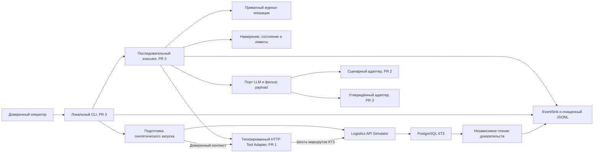
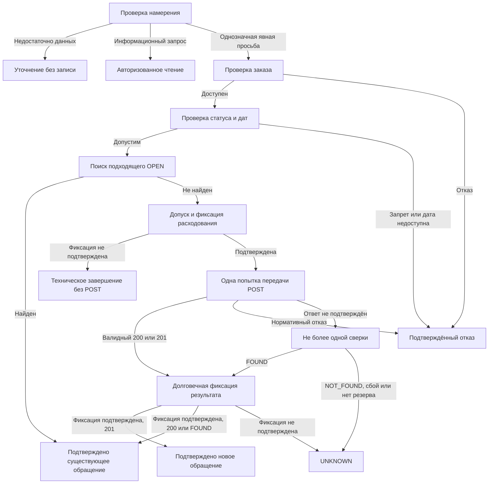

# Design — КТ4 Logistics Agent

## Context

Change-id `kt4-logistics-agent`, база `76ac62de74a40840a076e40affdc731817ac0928`. Утверждены 12 AC-LAG и 24 SC-LAG. Стадия Design ожидает отдельного решения. [Issue №25 и утверждение Requirements](https://github.com/andreigkuznetsov/ai-agents-qa-demo/issues/25#issuecomment-7142300770) · [Proposal](proposal.md) · [Requirements](specs/logistics-agent/spec.md) · [Решения КТ4](../../../docs/development/kt4-business-decisions.md)

КТ3 предоставляет авторизованный Logistics API Simulator, синтетические fixtures и управляемые внутренние отказы до и после фиксации. КТ4 добавляет последовательный Python executor поверх HTTP. Контекст создаётся доверенным контуром. [Контракт КТ3](../../specs/logistics-api-simulator/spec.md) · [Принятая таблица HTTP](../archive/2026-11-24-kt3-logistics-api-simulator/proposal.md)

## Goals / Non-Goals

- Сделать решение о записи и подтверждение её исхода проверяемыми на границах модели, журнала, HTTP и БД.
- Уложить работу в три согласованных среза. PR 1 создаёт типизированный адаптер. PR 2 добавляет исполнение и сценарные доказательства. PR 3 добавляет один утверждённый реальный адаптер и локальный live S01.
- Сохранить КТ2 и КТ3 без изменения таблиц, HTTP-контрактов, ролей БД, ревизий, Docker/CI и существующих эксплуатационных настроек. Публичный API управления, QA Agent, QA Engine, полные tracing и replay, систематическая оценка реальных моделей и расширенная fault injection остаются за границами КТ4.

## Decisions

### D-LAG-01. Компоненты и доверенные границы

`TrustedContext` приходит из серверной сессии тестового запуска. Содержит `run_id`, `client_id`, Bearer, доверенный `reference_year` при наличии и привязку к проверенному локальному адресу API. КТ3 серверно разрешает Bearer в пару клиента и запуска. Executor связывает контекст с идентичностью операции и проверяет совпадение при повторной доставке. Публичные аргументы, HTTP query, пользовательский текст и ответ модели не могут заменить контекст, создать его или указать произвольный API.

Доверенный контур подготовки использует полномочия для создания запуска и загрузки fixtures отдельно от executor. Executor работает с клиентским Bearer и журналом своей операции. Он не получает DSN, права загрузчика, SQL или управление отказами. Наблюдатель доказательств работает отдельно в синтетическом контуре с доступом на чтение. Он возвращает проверенные инварианты, без передачи строк БД модели.

### D-LAG-02. HTTP Tool Adapter

| Инструмент | Разрешённые аргументы | Фиксированный маршрут | Результат и разрешение |
| --- | --- | --- | --- |
| `get_order` | `order_id` | GET `/orders/{order_id}` | Идентификатор, статус, исходная дата. Заказ из проверенного намерения или доверенного состояния. |
| `get_delivery_options` | `order_id` | GET `/orders/{order_id}/delivery-options` | Доступность, причина и ISO-даты. Только для проверенного заказа. |
| `get_order_cases` | `order_id` | GET `/orders/{order_id}/cases` | Список типизированных case. Авторизованное чтение или поиск дубликата для того же заказа. |
| `get_case` | `case_id` в формате UUID | GET `/cases/{case_id}` | Типизированный case. Идентификатор из явного запроса на чтение или доверенного результата текущей операции. |
| `create_case` | `order_id`, ISO `requested_date` | POST `/cases` | `201` новый или `200` существующий case. Тип `DELIVERY_RESCHEDULE` и заголовок с исходным ключом задаёт сервер. Доступен после допуска записи. |
| `check_case_result` | Только доверенные заказ и ключ операции | GET `/orders/{order_id}/case-result` | `FOUND`, `NOT_FOUND` или недоступность. Executor вызывает сам после возможной передачи POST. Схема выбора модели этот инструмент не публикует. |

Аргументы проходят строгую проверку без приведения неверных типов и без лишних полей. Идентификаторы проверяются по типу и кодируются как один сегмент URL. Метод, база URL, тело и заголовки формируются адаптером. HTTP redirects и транспортные повторы выключены. Bearer добавляется в HTTP-клиенте. Он отсутствует в схемах инструментов. Исходный ключ повторно используется только для одного чтения результата операции. Условия формата ключа по КТ3 применяются без изменений.

Типы ответов используют поля из Requirements и перечисления КТ3. Адаптер проверяет статус, форму тела, совпадение целевого идентификатора и, для подтверждения записи, ожидаемые заказ, запрошенную дату, тип и статус case. Модели передаётся проекция разрешённых структурированных полей и безопасный код ошибки. Неизвестная структура или противоречивое тело приводят к техническому исходу. Дополнительные поля ответа в проекции отсутствуют. Сырые заголовки, body и исключения адаптер наружу не передаёт.

| Ответ | Обработка |
| --- | --- |
| `200` / `201` | Принимается только допустимая для маршрута форма. Для POST `201` подтверждает новое обращение, `200` — существующее. |
| `401 UNAUTHENTICATED` | Завершение с отказом доступа. Автоматической смены Bearer нет. После возможного POST отказ доступа на сверке оставляет `UNKNOWN`. |
| `404 RESOURCE_NOT_FOUND` | Единое публичное сообщение для отсутствующего, чужого и межзапускового объекта. На сверке после возможного POST исход остаётся `UNKNOWN`. |
| `409 ORDER_TRANSFER_BLOCKED` / `IDEMPOTENCY_KEY_CONFLICT` | Подтверждённый отказ данного POST. Конфликт фиксируется безопасно. Сервер не выдаёт новый ключ. |
| `422 DELIVERY_DATE_NOT_ALLOWED` / `VALIDATION_ERROR` | Подтверждённый отказ данного запроса, без новой записи и повтора. При недопустимой дате пользователю можно предложить сообщить другой вариант. |
| `503 RESULT_CHECK_UNAVAILABLE` | Результат POST остаётся `UNKNOWN`. |
| Тайм-аут, разрыв, неожиданный статус, повреждённое или несогласованное тело | Чтение даёт контролируемый технический исход. Если POST мог быть передан, исход неопределён. Одной сверкой управляет executor. |

### D-LAG-03. Намерение и переходы

Модель может предложить намерение, идентификатор и дату. Формат предложения ограничен схемой. Сервер проверяет источник каждого значения до допуска записи. Для автоматического допуска КТ4 поддерживаются однозначные явные формулировки просьбы о переносе или создании обращения. Исполнитель сверяет их с исходной репликой текущего пользователя или однозначно подтверждёнными значениями этой же доверенной сессии. Вопрос о возможности переноса, условная или отрицательная фраза и противоречивые значения не дают разрешения на запись. При неясной просьбе сервер выдаёт вопрос на уточнение. Свободная интерпретация модели сама по себе права на POST не создаёт.

Один отсутствующий, неполный или неоднозначный номер и выбор из нескольких заказов ведут к уточнению без перебора ID. Для даты с годом сервер нормализует календарно корректное значение к ISO и сверяет с `delivery-options`. Для даты без года требуется доверенный `reference_year` и единственное совпадение дня и месяца среди доступных дат, относящееся к этому году. Относительные даты и несколько вариантов уточняются. Системное время используется для технических дедлайнов. Бизнес-дату оно не определяет. Для допустимого явного запроса дополнительного подтверждения нет.

Executor формирует конечные факты из своего состояния. В ответе можно сообщить о создании или наличии обращения. Исходная дата доставки сохраняется. При недостоверном результате исполнитель сообщает об отсутствии подтверждения. Для уже найденного `OPEN` сопоставление по типу, заказу и дате выполняет сервер. Если дубликат возник между чтением и записью, `200` КТ3 подтверждает его. Если между чтением и записью изменились условия, backend остаётся источником актуального решения и может вернуть отказ без побочной записи.

### D-LAG-04. Долговечное состояние операции

Рекомендуется приватный локальный журнал на SQLite из стандартной библиотеки Python. Один доверенный хост владеет каталогом хранения. Журнал и очищенный JSONL имеют разные назначения и файлы.

| Вариант | Атомарность, повторы и восстановление | Доступ, миграции, тестирование и сложность |
| --- | --- | --- |
| Состояние в существующем PostgreSQL | Уникальный ID операции, условное изменение и синхронный commit дают атомарный допуск между процессами и хостами. При неоднозначном результате commit процесс прекращает запись. Восстановление читает то же состояние из БД. Commit журнала всё равно отделён от HTTP и commit case. | Нужны отдельные таблица или схема, права роли, миграция, обратная совместимость, правила резервирования и проверка доступности БД при восстановлении. Интеграционные тесты с настоящей БД и отказами сети повышают стоимость первого среза. Вариант пригоден для многосерверного запуска при отдельном согласовании. |
| Локальный SQLite с атомарной транзакцией | Уникальный ID и короткие транзакции защищают от двух допусков на одном хосте. Процессы используют общий локальный файл. При недоступности или неясном commit запись закрыта. Поведение восстанавливается по журналу и подтверждённым фактам. | Изолированный каталог и права ОС, локальная версия схемы. Нет DDL и новых ролей в PostgreSQL КТ3. Удобны сбои реальной фиксации и тесты двух процессов. Понадобится проверка локальной ФС и блокировок на целевой ОС. Межхостовая координация вне КТ4. |
| Плоский файл с append или atomic rename | Потребуются свои протоколы блокировки, атомарного обновления, синхронизации каталога и восстановления неполной записи. | Усложняет кроссплатформенные доказательства. Очищенный JSONL используется для событий, транзакционное решение хранит SQLite. |

Для SQLite предлагается rollback journal с `journal_mode=DELETE`, `synchronous=EXTRA` и проверкой обоих фактических режимов при открытии. Хранение поддерживается на локальной ФС с корректным выполнением синхронизации и блокировок. Сетевые и синхронизируемые каталоги исключены из проектируемой конфигурации. Транзакции короткие и не удерживаются во время HTTP или LLM. Возможности durability зависят от ФС и оборудования. Плановые доказательства КТ4 относятся к сбоям процессов и отказам записи. [SQLite locking](https://www.sqlite.org/lockingv3.html) · [SQLite synchronous](https://www.sqlite.org/pragma.html#pragma_synchronous) · [PostgreSQL WAL и synchronous commit](https://www.postgresql.org/docs/18/runtime-config-wal.html)

#### Минимальная модель записи

| Поле | Назначение |
| --- | --- |
| `operation_id`, `run_id`, `client_id` | Серверная идентичность операции и привязка авторизации. ID создаётся при доверенном допуске и сохраняется при повторной доставке. |
| `order_id`, `requested_date`, `operation_type`, `idempotency_key` | Неизменяемые параметры допуска. Ключ генерируется криптографически случайным серверным значением в безопасном ASCII-формате в пределах контракта КТ3. Параметры и ключ долговечно фиксируются вместе с расходованием разрешения. |
| `post_permit_consumed`, `transport_observed`, `result_check_consumed` | Три отдельных признака. Для передачи POST используется наблюдение `HANDED_OFF` либо `UNOBSERVED`. Расходование допуска не преобразуется в наблюдение передачи. |
| `outcome`, `evidence_kind`, `case_id` при наличии | Контролируемый итог и минимальная ссылка на проверенное свидетельство. Версия схемы хранится в журнале. Сырых реплик, Bearer, DSN и credentials в журнале нет. |

Сохранённый ключ остаётся приватным материалом ограниченного доступа. Файл и служебные файлы SQLite, блокировки и каталог должны наследовать ограничения доступа ОС от доверенного каталога. Журнал исключается из Git и пакетов отчёта. Ключ нельзя экспортировать, включать в исключения или передавать модели. Существующий журнал с неизвестной версией, повреждённый журнал или потеря журнала для уже выданного ID останавливают операцию. Для повторной доставки пустой журнал автоматически не создаётся. Создание нового журнала допускается только при явной подготовке нового синтетического запуска.

#### Проверка доверенного каталога

- Путь берётся из локальной доверенной конфигурации, вне репозитория и синхронизируемых каталогов. Принимается абсолютный путь к каноническому каталогу. Проверяются каждый компонент и фактические родительские каталоги, от которых зависит защита от переименования или подмены. Сравнение ведётся по компонентам и идентичности тома и файла из открытых дескрипторов. Внешние пути, разные алиасы одного настроенного пути и неустановленная идентичность дают отказ.
- На Linux компоненты открываются относительно удерживаемого каталога с `O_NOFOLLOW` и `O_DIRECTORY` для каталогов. Для файлов используются открытие без следования символьным ссылкам и проверка через `fstat`. Фактическая точка монтирования сверяется для открытого каталога. Поддерживаются проверенные локальные профили на ext4, XFS или Btrfs. Сетевые, синхронизируемые, временные или нераспознанные файловые системы отклоняются. Доверенный каталог принадлежит UID оператора с правами `0700`. SQLite, служебные файлы и файлы блокировок принадлежат тому же UID, имеют права `0600` и защищены от замены посторонними. Создание происходит с ограниченным режимом доступа с первого открытия.
- На Windows компоненты открываются через `CreateFileW` с `FILE_FLAG_OPEN_REPARSE_POINT`, для каталогов также с `FILE_FLAG_BACKUP_SEMANTICS`. При обнаружении reparse point, включая symlink и junction, путь отклоняется. Проверяются конечный путь по handle и фактический том. Поддерживается проверенный локальный фиксированный NTFS-том. UNC, сетевые, съёмные и синхронизируемые расположения отклоняются. Закрытая DACL допускает доверенную учётную запись и необходимые системные субъекты. Проверяется отсутствие доступа недоверенных субъектов к SQLite, служебным файлам и блокировкам и отсутствие возможности замены через права на родителя. Handle доверенного каталога и lock-файла открываются без `FILE_SHARE_DELETE` и удерживаются в пределах операции.
- Для уже существующих SQLite, `-journal` и других обнаруженных служебных файлов, а также lock-файлов проверяются принадлежность, обычный тип файла, отсутствие ссылок и лишних жёстких ссылок. Несовместимое состояние журнала отклоняется. `operation_id` разбирается как выданный сервером UUID и преобразуется в 32 строчных шестнадцатеричных символа. Имя lock-файла — эта строка и фиксированный суффикс `.lock`. Пользовательский путь, разделители и расширения не принимаются. На Linux lock-файл открывается относительно проверенного каталога, на Windows сверяется итоговый объект открытого handle. SQLite открывается только после проверки каталога и существующих файлов. Его служебные файлы защищаются закрытым каталогом и ограничениями при создании.
- Проверки выполняются до внешних вызовов, включая health и обращение к провайдеру. Повторно сверяется идентичность доступных путей перед открытием журнала или lock-файла. Если свойства безопасности не подтверждены, preflight возвращает `BLOCKED_PRECONDITION`. Диагностика отправляется по безопасному каналу. При небезопасном каталоге используется fallback stderr без открытия SQLite или JSONL в этом каталоге. Публичного управления хранилищем нет. Профиль доверяет ОС, учётной записи оператора и субъектам администрирования хоста. [Python os](https://docs.python.org/3/library/os.html) · [Windows reparse points](https://learn.microsoft.com/en-us/windows/win32/fileio/reparse-point-operations) · [Windows final path by handle](https://learn.microsoft.com/en-us/windows/win32/api/fileapi/nf-fileapi-getfinalpathnamebyhandlew)

#### Протокол конкуренции и сбоя

1. До чтения или создания допуска executor пытается получить эксклюзивную неблокирующую блокировку файла операции. На Linux используется `fcntl.flock(fd, LOCK_EX | LOCK_NB)`. На Windows — Win32 `LockFileEx` через `ctypes`, один байт с нулевого смещения, `LOCKFILE_EXCLUSIVE_LOCK | LOCKFILE_FAIL_IMMEDIATELY`. Открытый дескриптор или handle уникален для попытки, не дублируется и не наследуется дочерним процессом. Linux-воркеры создаются до захвата или отдельным запуском процесса. Область блокировки — один `operation_id` в одном доверенном каталоге на одном хосте. Она удерживается от чтения допуска до завершения операции, включая HTTP, сверку и фиксацию итога. SQLite-транзакции при этом остаются короткими.
2. При занятости возвращается «в работе» без ожидания, сетевых вызовов, захвата по тайм-ауту или смены ключа. Прочие ошибки блокировки дают технический отказ. При штатном выходе дескриптор освобождается и закрывается. После аварийного завершения ОС освобождает блокировку при закрытии последнего относящегося к ней дескриптора или handle. Повторная доставка может получить блокировку, когда освобождение фактически завершилось. Файл блокировки сохраняется, в том числе после падения. После захвата executor заново читает SQLite и проверяет принадлежность записи. Уже израсходованное разрешение запрещает второй POST независимо от того, был ли предыдущий вызов наблюдаемым. Для несовпадающего контекста запись не раскрывается. SQLite обеспечивает атомарность маркера, а межпроцессное владение доказывается отдельно. [Python fcntl](https://docs.python.org/3/library/fcntl.html) · [Windows LockFileEx](https://learn.microsoft.com/en-us/windows/win32/api/fileapi/nf-fileapi-lockfileex)
3. Под блокировкой исходный запуск создаёт запись допуска. Для попытки записи выполняется условный атомарный переход по ожидаемому состоянию. В одной транзакции сохраняются параметры, исходный ключ и факт расходования разрешения. Только подтверждённый успешный commit даёт текущему исполнителю право на единственную передачу HTTP. Отказ, занятость хранилища или неоднозначность результата фиксации завершают данный запуск без вызова транспорта и повтора. Если хранилище недоступно, безопасный технический код фиксируется через отдельный EventSink или минимальный структурированный stderr.
4. Транспортный адаптер наблюдает границу передачи запроса HTTP-клиенту. По возможности отдельно сохраняет факт передачи. Этот факт означает вызов транспортного слоя. При отключении процесса он может остаться ненаблюдённым, даже если HTTP-вызов произошёл. Он не подтверждает доставку или commit на стороне КТ3.
5. Валидные коррелированные `201`, `200` POST или `FOUND` позволяют сохранить результат. Для долговечного подтверждения обращения нужен подтверждённый commit его минимального свидетельства в SQLite. При ошибке или неопределённом commit оператор получает `UNKNOWN` с кодом сбоя локальной фиксации. Наблюдавшийся HTTP-успех может быть отмечен как отдельный технический факт. Долговечно подтверждённый успех в этой попытке запрещён. Сверка и POST автоматически не повторяются.
6. EventSink сохраняет очищенное доказательство отдельно. При его отказе fallback — одна запись по разрешённой схеме в локальный stderr, только безопасный код, внутренний ID операции и признаки доступности двух каналов. Сырые тела, ключи, пути и исключения не выводятся. Если stderr тоже недоступен, CLI завершает попытку ненулевым кодом. Отсутствующее итоговое свидетельство остаётся неполным. Если сохранился только SQLite, оператор может прочитать подтверждённый факт обращения, а отчёт попытки остаётся `INCONCLUSIVE` без `PASS`. Если SQLite и EventSink оба отказали, оператор получает `UNKNOWN` для операции, попытка остаётся без успешной приёмки. Резервная диагностика не заменяет доказательство.
7. При повторной доставке после остановки захват освобождённой блокировки позволяет прочитать сохранённый итог. При расходованном разрешении без доказанного результата возвращается `UNKNOWN`, в том числе если транспорт был `UNOBSERVED`. При незавершённой операции без израсходованного разрешения возвращается безопасное техническое завершение. Если после неоднозначной фиксации обнаруживается и проверяется уже сохранённое коррелированное свидетельство, повторная доставка возвращает его без внешних вызовов. При его отсутствии результат остаётся неопределённым. Недостающий EventSink не меняет сохранённый факт и не делает предыдущую попытку успешной. Автоматически продолжать прежнюю операцию или выдавать новый ключ нельзя. В предлагаемом варианте автоматическая сверка после рестарта также отключена. Данные об исходном ключе остаются приватными. В обычном процессе сверка предусмотрена только для своей попытки с возможной передачей POST.

### D-LAG-05. Сверка, бюджеты и сменный LLM

Executor сверяет только после возможной отправки и неопределённого результата POST. До допуска записи проверяются остатки времени на одну попытку сверки и завершение, а также остаток общего числа попыток инструментов. Перед сверкой её разрешение расходуется отдельной условной записью в журнале. При ошибке сохранения сверка не выполняется и возвращается `UNKNOWN`. `FOUND` подтверждает связанное обращение без утверждения, что предыдущий HTTP-ответ был получен. `NOT_FOUND` означает отсутствие подтверждения на момент чтения, включая незавершённую транзакцию. Ошибка доступа, недоступность и дедлайн сохраняют `UNKNOWN`. Второй POST, вторая сверка и повтор LLM-запроса автоматически не запускаются.

| Счётчик | Граница расходования |
| --- | --- |
| Модель, максимум 6 | Перед обращением к адаптеру, включая ошибки, тайм-аут и отмену после допуска. SDK и HTTP-слой без автоматических повторов и fallback. |
| Инструменты, максимум 6 | До проверки внешнего предложения, включая отклонение, либо перед внутренней сверкой. Отклонённый пакет учитывает предложенные попытки в пределах оставшегося бюджета и не исполняет ни одну. |
| POST, максимум 1 | Долговечное расходование допуска непосредственно перед передачей транспорту. Отклонённое модельное предложение только расходует попытку инструмента. |
| Сверка, максимум 1 | Однократное долговечное расходование перед GET с тем же контекстом и ключом. Одновременно учитывается одна попытка инструмента. |

Общий дедлайн и оставшееся время измеряются монотонными часами. Каждый вызов ограничен меньшим из собственного утверждённого лимита и остатка общего времени с учётом резерва. Проверка стоимости перед каждым live-вызовом использует утверждённую конфигурацию тарифа, лимиты входа и выхода и консервативный резерв. Если тариф или верхняя оценка недоступны, новый расход не допускается. Неизвестный usage удерживает резерв до сверки, следующие запросы блокируются при невозможности подтвердить остаток. Записывается источник оценки. Дедлайн ограничивает ожидание executor, завершение удалённой работы и биллинг подтверждаются отдельно. Эксплуатационные бюджеты и варианты A/B открыты. [Решения КТ4](../../../docs/development/kt4-business-decisions.md)

Порт LLM получает очищенный диалог, проекции результатов, доступные схемы, лимиты контекста, дедлайн и выбранную конфигурацию модели. Он возвращает типизированный текст или предложения инструментов, метаданные usage, идентификатор фактической модели и безопасный результат ошибки. Executor является единственным диспетчером. В PR 2 сценарный адаптер подставляет заранее заданные ответы. При прямых тестах API разрешения на запись и сверку выдаёт только доверенный тестовый контур. PR 3 реализует только согласованный реальный адаптер. OpenAI, Anthropic, OpenRouter и Ollama остаются кандидатами DEC-08. Доступность и строгие схемы upstream проверяются на preflight. Серверная валидация обязательна для любого провайдера.

### D-LAG-06. Безопасность и наблюдаемость

- Жёсткий реестр из шести функций и проверка разрешённых на текущем шаге инструментов применяются до HTTP. Произвольные инструменты, заголовки, контекст и URLs отклоняются. Один модельный ответ может вызвать максимум один инструмент. Пакет с несколькими вызовами отклоняется целиком.
- Типизированные проекции пропускают только нужные для текущего шага значения. Строки из инструмента считаются данными. Неизвестные поля отбрасываются. Недопустимые значения известных полей, невалидный payload и несовпадение контекста дают технический отказ. Системные инструкции, занесённые в ответ инструмента, не меняют серверную политику.
- На входе порта и на последней границе сериализации проверяются разрешённые поля. Тесты перехватывают фактический вход адаптера и исходящее тело запроса в тестовом транспорте. Разные синтетические маркеры для Bearer, ключа и credentials подставляются в соответствующие доверенные источники и провоцирующие ответы. Ни один маркер не должен попасть в тело модели, схемы или метаданные. В PR 3 разрешённые реквизиты аутентификации провайдера используются только его HTTP-клиентом в предусмотренном заголовке. Тестовый перехват подтверждает это отдельно, сохраняя только результат проверки. Сырые payload и заголовки не публикуются.
- Минимальный EventSink принимает версионированные события и строит очищенный JSONL по явному списку полей. События включают SHA, версию и хеш fixture и промпта, идентификатор модели, `series_id`, `attempt_id`, синтетический `run_id`, `operation_id`, `turn_id`, `tool_call_id`, фазу, безопасный код причины, UTC-метку, длительность, счётчики, источник usage и расходов, ссылку на проверку БД. Публичный итог — безопасная структурированная категория с подтверждёнными синтетическими фактами. Клиентские credentials, ключи, пользовательские реплики, сырые запросы и ответы, персональные данные и скрытые рассуждения исключаются.
- Запись допуска или блокировки попытки предшествует платному вызову. Каждая попытка получает итог `PASS`, `FAIL`, `INCONCLUSIVE` или `BLOCKED_PRECONDITION`. При повторном открытии сборщик отчёта видит незавершённые записи и сохраняет их как неподтверждённые после установления остановки процесса. Пробел в обязательных доказательствах исключает live `PASS`. Позднейшая КТ5 может подключить хранилище событий через тот же интерфейс.

### D-LAG-07. Локальный операторский запуск

На входе CLI доверенный оператор задаёт согласованный локальный профиль и выбирает синтетический сценарий. Публичной точки управления нет. Preflight сначала подтверждает безопасность доверенного каталога, журнала и канала отчёта по D-LAG-04. Только затем проверяет разрешённую среду и доступ, утверждённые модель и бюджеты, поддержку инструментов, health/readiness и параметры тестового стенда. Проверки провайдера, способные тарифицироваться, разрешаются и учитываются заранее. При недостающем допуске или отказе preflight отчёт фиксирует `BLOCKED_PRECONDITION`. Сценарный адаптер допуск к live не подменяет.

Для каждой новой разрешённой live-попытки доверенный контур создаёт отдельный `run_id` через RunStore и применяет закреплённый синтетический fixture с проверкой версии и хеша. Полномочия загрузчика остаются внутри подготовки. Для HTTP запускается уже существующий Logistics API в авторизованном локальном контуре с привязкой Bearer к клиенту и запуску. Необходимые параметры write/result задаются явно для согласованной тестовой среды. Исходные контракты и бюджеты КТ2 не меняются. Сырые пользовательские данные в live не используются. Наблюдатель независимо читает синтетическую область в PostgreSQL и фиксирует число обращений, целевые заказ, контекст и дату и сохранность исходной даты доставки. Автоматической очистки или перезаписи предыдущих попыток нет.

## Test Strategy

### Проверка критических границ

- **Отказ долговечной фиксации, SC-LAG-010.** С реальным SQLite вызвать ошибку на границе commit, например защищённым только для тестов ограничением записи или занятым хранилищем с ограниченным ожиданием. Отдельно симулировать потерю подтверждения commit после долговечного изменения. Наблюдатель HTTP-транспорта видит ноль POST. Проверяются отсутствие подтверждения расходования, автоматического повтора и успешного ответа. Техническое событие содержит безопасный код. Повторная доставка не пытается записать заново даже при неоднозначном commit.
- **Остановка после расходования, SC-LAG-010.** Дочерний исполнитель останавливается по управляемому барьеру после подтверждённого commit и перед обращением к HTTP. Завершить процесс, открыть тот же каталог новым процессом и доставить исходный ID. Проверить `post_permit_consumed`, отсутствие наблюдения передачи, ноль POST, без заявления об отправке и результате.
- **Остановка после передачи, SC-LAG-011.** Отдельный HTTP-наблюдатель регистрирует передачу. Для двух вариантов удерживает момент до фиксации или теряет ответ после неё на реальном Simulator. Остановить процесс до надёжного сохранения результата. После повторной доставки проверить `UNKNOWN`, отсутствие дополнительных POST и ключей и состояние PostgreSQL после освобождения барьера. Вариант с фиксацией может содержать одну строку case, вариант с откатом — ни одной.
- **Конкурентная доставка, SC-LAG-011.** Два процесса, независимые подключения SQLite, общий каталог и идентичный серверный ID. Барьер удерживает победителя на границе расходования. Второй получает «в работе» или сохранённый итог без транспорта. Счётчик наблюдаемого POST равен одному, в БД ровно один case. Подмена контекста для того же ID не возвращает чужой итог. На Windows и Linux обязательны реальные двухпроцессные испытания штатного освобождения, немедленного отказа конкурента, аварийного завершения владельца и последующего захвата с чтением израсходованного разрешения. После освобождения проводится ограниченная по времени проверка захвата. Ни второй POST, ни смена ключа при этом не допускаются.
- **Отказ результата и доказательств, SC-LAG-011/019/020.** Реальный Simulator возвращает валидный 200 и 201 в отдельных вариантах. После каждого ответа воспроизводятся отказ фиксации результата SQLite, отказ EventSink и их одновременный отказ. Контролируемые тестовые точки затрагивают фиксацию результата после ранее успешной записи маркера. Проверяются безопасный статус, отсутствие `PASS`, allowlist полей stderr, ненулевой код при недоступности резервного канала, один POST и ноль автоматических сверок. После рестарта результат читается из SQLite либо остаётся `UNKNOWN`. Независимое чтение PostgreSQL показывает фактическое состояние обращения. Вариант с неоднозначным commit проверяет возврат найденного сохранённого свидетельства без вызовов наружу.
- **Небезопасный каталог, SC-LAG-003/010/021/022.** На Windows и Linux проверяются ошибочная канонизация, доступ постороннего субъекта, подмена каталога и существующих файлов, symlink или junction, жёсткая ссылка, неподдерживаемый том и некорректный ID. Для PR 2 проверяются защита локального журнала и фактическая блокировка. Для PR 3 негативный preflight подтверждает `BLOCKED_PRECONDITION` и ноль сетевых вызовов, включая health и LLM. Синтетические артефакты расположены в изолированном каталоге теста.
- **Независимые лимиты, SC-LAG-017.** Четыре изолированные проверки счётчиков с доверенной установкой начального состояния. Целевой счётчик доводится до границы, прочие остаются ниже своих пределов. Сравниваются счётчики порта модели и HTTP-пробника до и после седьмого модельного вызова, седьмой попытки инструмента, второго POST и второго GET сверки. В составном тесте проверяются совместный расход попытки инструмента и сверки, резерв, отсутствие скрытых повторов и отказ всего пакета.
- **Проверка секретов, SC-LAG-003/019.** Независимые синтетические метки проверяются на входе порта, в сериализованном запросе каждого применимого адаптера и отдельно в публикуемых событиях. Для PR 1 применяется тестовый потребитель проекции, для PR 2 — перехват входа сценарного порта, для PR 3 — перехват сериализации реального адаптера с тестовым транспортом до обращения к провайдеру. Сырые запросы в доказательства не записываются.
- **Неизвестный POST, SC-LAG-014/015.** Реальные транзакции PostgreSQL на стенде КТ3. Внутренние fault profiles изолированы по контексту. Проверить потерю ответа после commit с `FOUND`, откат до commit, чтение до видимости commit с `NOT_FOUND`, отказ или дедлайн сверки. Проверить исходный ключ, тот же контекст, максимум один GET сверки, один отправленный POST и отсутствие новых записей от GET. Физический сетевой разрыв выходит за пределы этих свидетельств.
- **Сценарные S01–S06, SC-LAG-023.** Сценарный адаптер только задаёт выходы модели. Backend КТ3 и PostgreSQL действительные, вызовы проходят через HTTP-адаптер. Синтетические контексты и новое состояние разделены по `run_id`. Успех, дубликат и отказы проверяются HTTP-счётчиком и независимым чтением БД. Для сценариев, где нужен сетевой факт, используется локальный наблюдаемый HTTP-транспорт. Для внутренних отказов допустим тестовый ASGI-контур КТ3 с реальной БД, а способ доставки указывается в доказательстве. КТ5, КТ6 и КТ9 сохраняют свои цели. Устойчивость живой модели к prompt injection из этого набора не выводится.

### Сценарный стенд S01–S06

Используются [fixture КТ3](../../../backend/tests/fixtures/logistics/v1.json), [доверенный загрузчик](../../../backend/tests/support/kt3_fixture_loader.py) и [исходный каталог сценариев](../../../docs/03_SCENARIOS.md). Подготовка не даёт агенту прав записи за пределами API. Публичные и технические инварианты проверяет наблюдатель, которому доступны только синтетические данные выбранного запуска.

| Сценарий | Контекст проверки | Доказательство PR 2 |
| --- | --- | --- |
| S01 | Клиент B, `order-001`, дата запроса 26.11.2026, исходная 25.11.2026 | Проверки заказа, дат и дубликата предшествуют одному POST. Новый OPEN виден в БД, исходная дата сохранена. |
| S02 | Не передать ID или передать один неполный ID | Вопрос на уточнение, ноль попыток угадать ID, ноль POST, снимок БД без изменений. |
| S03 | `order-blocked`, `order-no-dates`, недопустимая дата и контролируемая смена статуса после чтения | Различимые причины, ни одной запрещённой записи. Поздний отказ проверяется настоящим API. |
| S04 | Подготовленный OPEN для клиента A и изолированная гонка для ещё не созданного case | Найденное обращение исключает POST. При гонке API возвращает 200, количество обращений не увеличивается действиями агента. |
| S05 | Внутренний отказ до и после фиксации case, отдельные контексты | Неизвестный исход, одна авторизованная сверка, корректное различие FOUND и UNKNOWN, отсутствие второго POST. |
| S06 | Номер из чужого контекста и внедрённый синтетический текст на границе инструмента | Равный 404, отказ запрещённого вызова и ноль раскрытий или записи. Ответ текстовой модели в реальном live не оценивался. |

Живой S01 в PR 3 повторяет условия первой строки на новом запуске. Порт получает ответы реального провайдера, а независимый наблюдатель подтверждает результат по критерию SC-LAG-024.

### Матрица SC-LAG → PR → доказательство

| SC-LAG | AC-LAG | PR | Метод и ожидаемый результат |
| --- | --- | --- | --- |
| 001 | 001 | 1 | Контрактный набор шести маршрутов на КТ3. Зафиксированы ожидаемые метод, путь, поля и статус, пустой список и обе формы сверки. |
| 002 | 001 | 1 | Табличные негативные аргументы и счётчик транспорта. HTTP не вызван. |
| 003 | 002 | 1, повтор 2–3 | Реальные одноимённые заказы в разных контекстах и три независимые секретные метки. Контекст не переопределён, маркеров в модельном payload нет. |
| 004 | 002 | 1 | Запрещённые операции, произвольный URL и смена роли. Ноль HTTP-вызовов. |
| 005 | 003 | 2 | Информационное намерение, отсутствующий, неполный, неоднозначный номер и несколько заказов. Уточнение при нехватке данных, ноль угадываний, перебора и POST. |
| 006 | 003 | 2 | Полная и однозначная частичная дата с доверенным годом. Явная просьба допускается без дополнительного подтверждения. |
| 007 | 003 | 2 | Относительные и неоднозначные даты, год без доверенного источника, недоступная абсолютная дата. Корректное уточнение или причина отказа, ноль POST. |
| 008 | 004 | 2 | Наблюдение порядка вызовов и преждевременное предложение POST. Запись выполняется только после проверок, в S01 ровно один новый case. |
| 009 | 004 | 2 | Существующий OPEN, гонка после чтения, блокировка и пустой список дат. Ноль лишних записей, различимые исходы, при гонке ожидаемый `200`. |
| 010 | 005 | 2 | Отказ фиксации, потеря её подтверждения и остановка после подтверждённой отметки до транспорта. Ноль POST и ложных подтверждений. |
| 011 | 005 | 2 | Захват и освобождение блокировки на Windows и Linux, конкурентная доставка, рестарт после передачи и отказ локальной фиксации после 200/201. Максимум одна отправка и один case, отсутствие второго ключа. |
| 012 | 006 | 1, регрессия 2 | Матрица штатных HTTP-кодов КТ3 с проверкой публичного тела и единого `404`. Запрещённая запись после смены условий не происходит. |
| 013 | 006 | 1, регрессия 2 | Ошибка транспорта, неожиданный статус, неверное или несогласованное тело. Безопасная классификация и отсутствие ложного успеха. |
| 014 | 007 | 2 | Потеря ответа после commit, единственный GET с исходным ключом и тот же контекст. `FOUND`, одна строка case. |
| 015 | 007 | 2 | Откат, незавершённая запись, отказ доступа, 503 или дедлайн при сверке. `UNKNOWN`, повторов нет. |
| 016 | 008 | 2 | Внедрённый текст, попытка чужого ID, запрещённый инструмент и пакет вызовов. Отклонение без раскрытия и побочной записи. |
| 017 | 009 | 2, регрессия 3 | Четыре независимые границы и счётчики на внешних портах. Ни один лишний вызов не выполнен. |
| 018 | 009 | 2, регрессия 3 | Управляемые часы и расход. Новый вызов или POST без остатка и резерва отклоняются, уже неопределённый исход сохранён. |
| 019 | 010 | 2, повтор 3 | Корреляция версионированных событий и безопасные синтетические маркеры. Значимые поля и статусы доступны, секретов нет. |
| 020 | 010 | 2, повтор 3 | Сценарные статусы, прерванная попытка и отказ EventSink отдельно и вместе с SQLite. Безопасный fallback, отсутствие неподтверждённого PASS, неизвестный расход отмечен. |
| 021 | 011 | 3 | Отказ preflight на условиях допуска или безопасности каталога. `BLOCKED_PRECONDITION`, при небезопасном пути ноль сетевых вызовов. |
| 022 | 011 | 3 | Изолированная подготовка CLI, отдельный синтетический run_id, проверка версии fixture и серверной выдачи контекста. |
| 023 | 012 | 2 | S01–S06 с реальным Simulator и сценарной LLM. Прилагаются исходы, порядок вызовов и независимые инварианты БД. |
| 024 | 012 | 3 | Один фактический живой S01 с допущенным провайдером и независимым БД-наблюдателем. `PASS` требует полного фактического свидетельства. |

PR 1 принимает только существенные для HTTP-адаптера доказательства. PR 2 закрывает сценарное поведение. PR 3 повторяет проверки на границах реального адаптера и отдельно предъявляет live-доказательство. В PR указываются точные SHA, среда, способ доставки, версии, счётчики и проверенные инварианты. Все PR проходят независимое ревью. Существенное изменение модели операций подлежит системному аудиту по принятым правилам. [Процедура SDD](../../../docs/development/sdd-process.md) · [Правила аудита](../../../docs/development/audit-process.md)

## Risks / Trade-offs

- **Отказ локальной ФС или неожиданный режим синхронизации** → проверка фактического режима при открытии, приватный локальный каталог, остановка при ошибке состояния, интеграционные проверки на целевой ОС.
- **Разрыв между локальной фиксацией, отправкой и commit КТ3** → независимые наблюдения, максимум один допуск на запись, одна сверка, безопасный `UNKNOWN`. Частный случай сбоя до отправки после фиксации допуска может завершиться неопределённостью без case.
- **Потеря журнала или перенос на другой хост** → запрет автоматической повторной доставки в пустое хранилище, явный запуск новой изолированной попытки. Многосерверное владение требует отдельного дизайна.
- **Недоверенный текст и свободная классификация намерения** → типизация, серверная проверка источника и контекста, консервативное уточнение при неоднозначности. Live S01 даёт наблюдение по одному сценарию.
- **Недоступный провайдер, неизвестная стоимость, сбой JSONL** → закрытый preflight, консервативный резерв, фиксация статуса и отсутствие `PASS` без полного доказательства. При недоступности и EventSink, и stderr остаётся ненулевой код завершения и неполное свидетельство.

## Migration Plan

1. После утверждения Design и Tasks публикуется planning baseline и по очереди проходят три согласованных PR. На PR 1 побочных миграций или runtime-изменений КТ3 нет.
2. На PR 2 версия локального SQLite-журнала создаётся только для нового доверенного запуска. Перенос и очистка старого состояния автоматически не выполняются. Возврат к предыдущей версии сохраняет приватные журналы. Работа с несовместимой версией блокируется. Состояние PostgreSQL КТ2 и КТ3 сохраняется.
3. PR 3 включает операторский entrypoint только после утверждения DEC-08 и live-параметров. При отключении entrypoint журналы и очищенные доказательства остаются доступны в доверенном контуре.

## Open Questions

- До PR 3 подтвердить DEC-08, разрешённую среду, аккаунт, провайдера и конкретную версию модели. Прогон без разрешённого доступа получает `BLOCKED_PRECONDITION`.
- Отдельно утвердить денежные и временные бюджеты, допустимые параметры тестового write/result и правила серии A/B. Параметры КТ2 и рабочие дефолты КТ3 не меняются.
- Подтвердить поддерживаемый локальный профиль хранения для выбранной среды и провести реальные проверки процесса и блокировок. Предложенный Design охватывает один хост и синтетический стенд.
